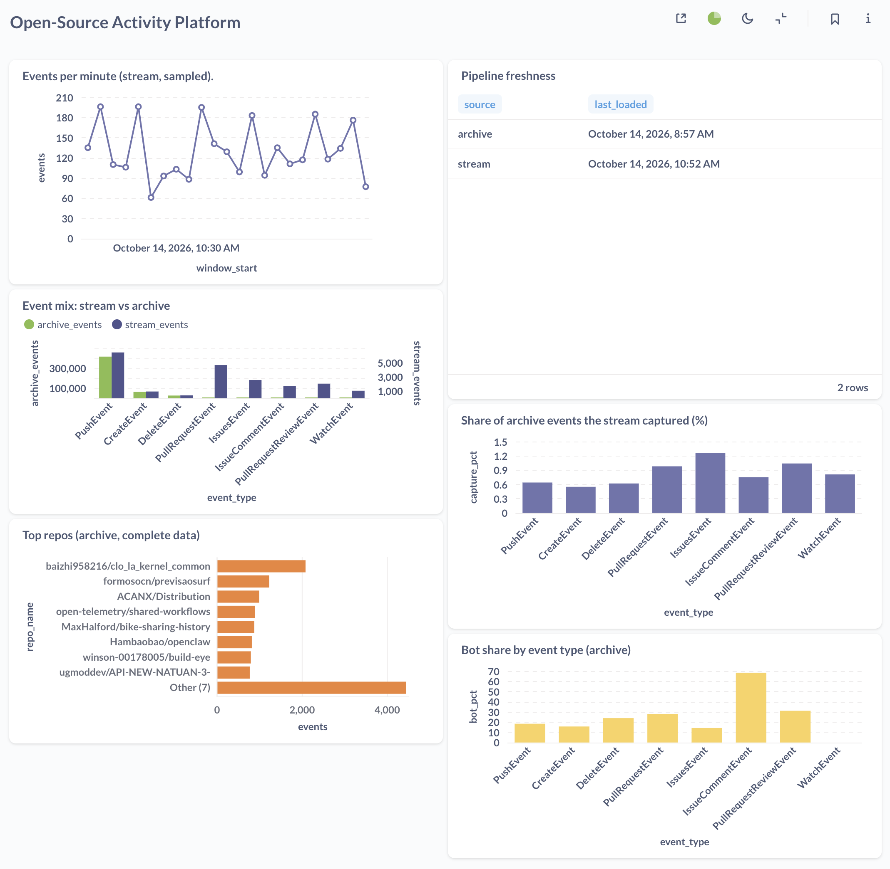
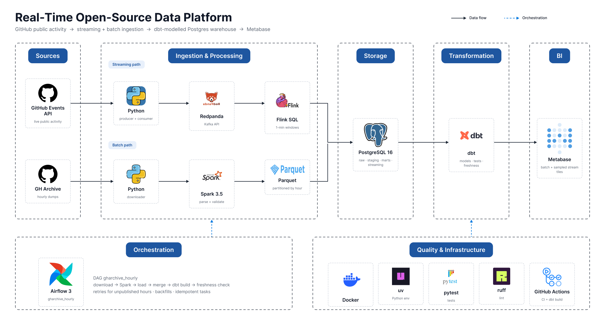

# Real-Time Open-Source Data Platform


A production-style data platform built on GitHub's public activity. A **streaming path** (GitHub Events API → Redpanda → Flink SQL and a Postgres loader) and a **batch path** (GH Archive → Spark → Parquet → Postgres) feed a dbt-modelled warehouse, orchestrated by Airflow and visualised in Metabase.

The goal was not just to move data but to treat ingestion like production code: idempotent loads, late-data handling, dead-letter queues, tests, CI, and cross-validating the two sources against each other.



## Architecture



## Stack

| Layer | Tools |
|---|---|
| Streaming | Redpanda (Kafka API), Flink 1.20 (SQL), Python producer and consumer |
| Batch | Spark 3.5, Parquet, GH Archive |
| Storage | PostgreSQL 16 (`raw`, `staging`, `marts`, `streaming` schemas) |
| Transformation | dbt (staging views, incremental fact, marts, tests, freshness) |
| Orchestration | Airflow 3 |
| BI | Metabase |
| Quality | pytest, ruff, GitHub Actions (including dbt build on seeded Postgres) |
| Infra | Docker Compose, uv |

## Quick start

```bash
cp .env.example .env
make setup
make up
```

Add a GitHub token (no scopes needed) to `.env`. Then open Redpanda Console (8080), Flink (8081), Airflow (8085) and Metabase (see `docker-compose.yml` for its port). Load historical data with:

```bash
make backfill FROM=2026-10-12T11:00:00+00:00 TO=2026-10-12T13:00:00+00:00
```

## How it works

**Streaming path.** The producer polls the GitHub Events API with conditional requests (ETag), obeys `X-Poll-Interval`, backs off on rate limits, de-duplicates in a bounded cache and uses an idempotent Kafka producer. The consumer commits Kafka offsets only after the Postgres transaction commits and inserts with `ON CONFLICT DO NOTHING`; malformed messages go to a dead-letter topic. A Flink SQL job computes 1-minute event-time tumbling windows per repo and event type and upserts them into Postgres.

**Batch path.** A resumable downloader fetches hourly GH Archive files. A Spark job parses them with an explicit schema, sends bad lines to a rejected folder and writes Parquet partitioned by archive hour, so reruns overwrite exactly what they reprocess. A second job loads a staging table and merges into `raw.gharchive_events` idempotently.

**Transformations.** dbt models parse the raw JSON, build an incremental hourly fact table (driven by load time so late events are never missed), a repo activity mart, a unified event model across both sources, and a source reconciliation mart. Singular tests assert row-count reconciliation between layers.

**Orchestration.** The `gharchive_hourly` DAG runs download → Spark → load → merge → dbt build → freshness check, with retries for not-yet-published hours and support for backfills. Every task is idempotent, so any hour can be re-run safely.

**CI.** Every push runs ruff and pytest, then builds the schemas, loads fixtures into a Postgres service container and runs the full dbt build.

## Findings

Reconciling the stream against the complete archive turned up real data-quality issues.

1. **The two sources disagree, and I could not fully explain why.** For hours 11-13 UTC on 2026-10-12 the archive holds about 84-86k events per hour. Only 116 of 1,324 stream events (8.8%) in that window exist in the archive. Matching on actor, repo, type and timestamp gives the same result, so this is not an ID problem.
2. **Event mix differs sharply.** The archive is 79% PushEvent and 0.9% PullRequestEvent. An early stream sample was about 40% and 21%. Only 1.5% of stream PullRequestEvents appear in the archive, against 24% of PushEvents. Hypotheses (spam or bot pushes inflating the archive, API-side filtering or delays) are untested.
3. **The Events API serves stale events.** Median lag between `created_at` and ingestion is about 5 minutes, but p90 is about 30 hours and p99 about 41 hours.
4. **Bugs caught along the way.** An incremental model that only reprocessed recent hours silently undercounted late events; a load-time watermark fixed it. A Flink source table with columns that did not match the nested JSON produced NULL timestamps, so watermarks never advanced; `json.ignore-parse-errors` had hidden the mismatch.

Consequence: the stream is used for freshness only, and the batch path is the reference for distributions and rankings. Dashboard tiles based on the stream are labelled as sampled.

## Design decisions

| Decision | Why |
|---|---|
| Flink SQL instead of PyFlink | PyFlink 1.20 pins dependencies that fail to install on Python 3.12 and later; SQL is also the idiomatic interface for windowed aggregation |
| Commit offsets after the DB commit, with a primary key | At-least-once delivery plus an idempotent insert gives effectively-once results |
| Parquet partitioned by archive file hour | Reruns overwrite exactly the hours they process, so late events cannot erase other hours |
| Raw JSONB for the stream, flattened Parquet for the batch | Stream payloads stay replayable; archive `.gz` files remain the source of truth |
| Postgres as the warehouse | Free, local and dbt-supported; the trade-off is that it is not columnar |
| Spark for the batch | Overkill at about 85k events per hour (DuckDB would do), but the same job scales to days or months by changing the input glob |

## Limitations

- Airflow runs in single-container standalone mode with authentication disabled; production would split scheduler, API server and workers.
- Flink runs as a single node without checkpoint-backed job recovery; the job is resubmitted on container start.
- Credentials in `docker-compose.yml` are local-development defaults.
- Events that arrive behind the Flink watermark are dropped from the windows.
- The cause of the stream/archive discrepancy is unresolved.

## Repository layout

```
ingestion/       producer, raw consumer, Dockerfile
streaming/       Flink SQL job, start script, JAR downloader
batch/           GH Archive downloader, Spark jobs, merge SQL
dbt/             sources, staging, marts, tests
orchestration/   Airflow image and DAGs
infrastructure/  Postgres init SQL
tests/           pytest suite and dbt CI fixtures
```
